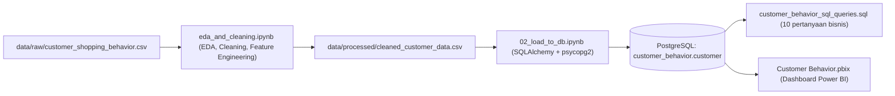

# Laporan Proyek: Customer Shopping Behavior & Revenue Optimization Analysis

> **Tanggal laporan:** 18 Oktober 2026
> **Cakupan:** Notebook Python (EDA, cleaning, load ke database) → Analisis SQL (PostgreSQL) → Dashboard Power BI
> **Dataset:** `customer_shopping_behavior.csv` — 3.900 transaksi, 18 kolom

---

## 1. Ringkasan Eksekutif

Proyek ini membangun alur analitik *end-to-end* untuk memahami perilaku belanja pelanggan ritel: data mentah dibersihkan dengan Python, dimuat ke PostgreSQL, dianalisis dengan 10 pertanyaan bisnis menggunakan SQL, lalu divisualisasikan dalam dashboard Power BI interaktif.

| KPI Utama | Nilai |
|---|---|
| Total Pendapatan | **USD 233.081** |
| Jumlah Pelanggan / Transaksi | **3.900** |
| Rata-rata Nilai Belanja (AOV) | **USD 59,76** |
| Rata-rata Review Rating | **3,75 / 5** |
| Tingkat Adopsi Langganan | **27,0%** |
| Transaksi dengan Diskon | **43,0%** |

**Temuan kunci:**
1. **Clothing** adalah penggerak utama pendapatan (USD 104.264; 44,7%), disusul Accessories (31,8%).
2. Pelanggan **pria** menyumbang 67,7% pendapatan, tetapi rata-rata belanja per transaksi **wanita sedikit lebih tinggi** (USD 60,25 vs 59,54).
3. **Diskon tidak menaikkan nilai belanja**: rata-rata transaksi berdiskon (USD 59,28) justru sedikit di bawah transaksi tanpa diskon (USD 60,13).
4. **Pelanggan langganan tidak berbelanja lebih banyak** per transaksi (USD 59,49 vs 59,87) — program langganan belum memberi nilai tambah yang terukur.
5. Mayoritas pelanggan (79,9%) masuk segmen **Loyal** (>10 pembelian sebelumnya), namun hanya 27,6% dari repeat buyer yang berlangganan → peluang konversi besar.

> [!WARNING]
> Ditemukan **kesalahan agregasi pada dashboard**: beberapa visual menggunakan `SUM(customer_id)` alih-alih `COUNT`. Akibatnya donut chart Subscription Status menampilkan **92,7% / 7,3%**, padahal proporsi sebenarnya **73,0% / 27,0%**. Detail di [Bagian 5.3](#53-temuan-isu-pada-dashboard).

---

## 2. Arsitektur & Alur Kerja



| Tahap | Artefak | Tools |
|---|---|---|
| 1. EDA & Cleaning | [eda_and_cleaning.ipynb](../notebooks/eda_and_cleaning.ipynb) | pandas, numpy |
| 2. Load ke Database | [02_load_to_db.ipynb](../notebooks/02_load_to_db.ipynb) | SQLAlchemy, psycopg2 |
| 3. Analisis SQL | [customer_behavior_sql_queries.sql](../sql/customer_behavior_sql_queries.sql) | PostgreSQL |
| 4. Dashboard | [Customer Behavior.pbix](../dashboard/Customer%20Behavior.pbix) | Power BI Desktop |

---

## 3. Tahap 1 — EDA & Data Cleaning (Notebook)

### 3.1 Profil Data Mentah

- **3.900 baris × 18 kolom**, tidak ada baris duplikat ID (`Customer ID` unik 1–3.900).
- Tipe data: 4 kolom integer, 1 float (`Review Rating`), 13 kolom teks/kategorikal.

| Fitur Numerik | Mean | Median | Min | Max |
|---|---|---|---|---|
| Age | 44,07 | 44 | 18 | 70 |
| Purchase Amount (USD) | 59,76 | 60 | 20 | 100 |
| Review Rating | 3,75 | 3,8 | 2,5 | 5,0 |
| Previous Purchases | 25,35 | 25 | 1 | 50 |

Semua fitur numerik terdistribusi simetris/merata (skewness ≈ 0) tanpa outlier ekstrem, sehingga **tidak diperlukan penanganan outlier**.

Karakteristik kategorikal penting: Gender tidak seimbang (Male 68%), Clothing mendominasi (44,5%), langganan hanya 27%, diskon dipakai di 43% transaksi.

### 3.2 Langkah Cleaning & Transformasi

| # | Langkah | Detail | Alasan |
|---|---|---|---|
| 1 | **Imputasi missing values** | 37 nilai kosong pada `Review Rating` diisi dengan **median per `Category`** (`groupby().transform()`) | Median tahan outlier dan cocok untuk skala rating terbatas; per kategori agar mencerminkan standar kepuasan tiap kelompok produk |
| 2 | **Standarisasi nama kolom** | Lowercase, spasi/tanda hubung → `_`, hapus karakter non-alfanumerik (mis. `Purchase Amount (USD)` → `purchase_amount_usd`) | Mencegah error sintaks di SQL, mendukung dot-notation pandas, konsisten lintas Python → PostgreSQL → Power BI |
| 3 | **Feature engineering: `age_group`** | `pd.qcut(age, q=4)` → `young adult` (18–31), `adult` (32–44), `middle-aged` (45–57), `senior` (58–70) | Segmentasi demografi dengan ukuran kelompok seimbang (942–1.028 pelanggan) |
| 4 | **Feature engineering: `purchase_frequency_days`** | Mapping teks → hari: Weekly=7, Fortnightly/Bi-Weekly=14, Monthly=30, Quarterly/Every 3 Months=90, Annually=365 | Frekuensi belanja dapat dianalisis secara kuantitatif |
| 5 | **Hapus redundansi** | `promo_code_used` di-drop setelah diverifikasi `(discount_applied == promo_code_used).all() == True` | Kedua kolom identik 100% |
| 6 | **Ekspor** | `data/processed/cleaned_customer_data.csv` | Input untuk tahap load |

**Hasil akhir:** 3.900 baris × **19 kolom**, **0 missing values**.

### 3.3 Load ke PostgreSQL

Notebook `02_load_to_db.ipynb` membaca CSV bersih dan memuatnya ke PostgreSQL:

```python
engine = create_engine(f"postgresql+psycopg2://{username}:{password}@{host}:{port}/{database}")
df.to_sql("customer", engine, if_exists="replace", index=False)
```

Output: `Data successfully loaded into table 'customer' in database 'customer_behavior'.`

---

## 4. Tahap 2 — Analisis SQL

File [customer_behavior_sql_queries.sql](../sql/customer_behavior_sql_queries.sql) menjawab 10 pertanyaan bisnis dengan teknik yang bertingkat: agregasi dasar → subquery → `CASE WHEN` kondisional → CTE → window function.

> [!NOTE]
> Angka hasil di bawah dihitung ulang dari `cleaned_customer_data.csv` (data yang sama dengan tabel `customer`) untuk verifikasi.

### Q1. Pendapatan berdasarkan gender
*Teknik: `GROUP BY` + `SUM`*

| Gender | Revenue (USD) | Transaksi | Rata-rata |
|---|---|---|---|
| Male | 157.890 | 2.652 | 59,54 |
| Female | 75.191 | 1.248 | 60,25 |

**Insight:** Pria menyumbang ~2/3 pendapatan karena jumlahnya lebih besar, bukan karena belanja per transaksi lebih tinggi.

### Q2. Pengguna diskon dengan belanja di atas rata-rata
*Teknik: subquery skalar `(SELECT AVG(...))`*

- **839 dari 1.677** transaksi berdiskon (50,0%) bernilai di atas rata-rata (USD 59,76).
- Rata-rata transaksi berdiskon **USD 59,28** vs tanpa diskon **USD 60,13**.

**Insight:** Diskon tidak mendorong *basket size* lebih besar — ada risiko diskon menggerus margin tanpa kenaikan nilai belanja.

### Q3. Top 5 produk dengan rating tertinggi
*Teknik: `AVG` + `ORDER BY` + `LIMIT`*

| Produk | Avg Rating |
|---|---|
| Gloves | 3,86 |
| Sandals | 3,84 |
| Boots | 3,82 |
| Hat | 3,80 |
| T-shirt | 3,78 |

**Insight:** Selisih rating antar produk sangat tipis (rentang ~0,08); belum ada produk yang benar-benar menonjol dalam kepuasan.

### Q4. Rata-rata belanja: Standard vs Express
| Shipping | Avg Purchase (USD) |
|---|---|
| Express | 60,48 |
| Standard | 58,46 |

**Insight:** Pelanggan Express membelanjakan ~USD 2 lebih banyak per transaksi — potensi *upsell* ongkir premium.

### Q5. Apakah pelanggan langganan berbelanja lebih banyak?
| Subscription | Pelanggan | Avg Spend | Total Revenue |
|---|---|---|---|
| No | 2.847 | 59,87 | 170.436 |
| Yes | 1.053 | 59,49 | 62.645 |

**Insight:** **Tidak.** Subscriber tidak menghasilkan nilai belanja per transaksi lebih tinggi; manfaat program langganan perlu dievaluasi ulang.

### Q6. Top 5 produk dengan persentase pembelian berdiskon tertinggi
*Teknik: agregasi kondisional `SUM(CASE WHEN ...) / COUNT(*)`*

| Produk | Discount Rate |
|---|---|
| Hat | 50,00% |
| Sneakers | 49,66% |
| Coat | 49,07% |
| Sweater | 48,17% |
| Pants | 47,37% |

Per kategori, tingkat diskon relatif merata: Outerwear 44,4%, Accessories 43,8%, Footwear 43,2%, Clothing 42,1%.

### Q7. Segmentasi pelanggan (New / Returning / Loyal)
*Teknik: `CASE WHEN` di dalam CTE*

| Segmen | Kriteria `previous_purchases` | Jumlah | Proporsi |
|---|---|---|---|
| New | = 1 | 83 | 2,1% |
| Returning | 2–10 | 701 | 18,0% |
| Loyal | > 10 | 3.116 | 79,9% |

### Q8. Top 3 produk terlaris per kategori
*Teknik: `ROW_NUMBER() OVER (PARTITION BY category ORDER BY COUNT(*) DESC)` + CTE*

| Kategori | #1 | #2 | #3 |
|---|---|---|---|
| Accessories | Jewelry (171) | Belt (161) | Sunglasses (161) |
| Clothing | Blouse (171) | Pants (171) | Shirt (169) |
| Footwear | Sandals (160) | Shoes (150) | Sneakers (145) |
| Outerwear | Jacket (163) | Coat (161) | — |

### Q9. Apakah repeat buyer (>5 pembelian) cenderung berlangganan?
| Subscription | Repeat Buyers |
|---|---|
| No | 2.518 (72,4%) |
| Yes | 958 (27,6%) |

**Insight:** Proporsi langganan pada repeat buyer (27,6%) hampir sama dengan populasi umum (27,0%) — loyalitas belanja **tidak** otomatis berujung pada langganan.

### Q10. Kontribusi pendapatan per kelompok usia
| Age Group | Revenue (USD) |
|---|---|
| young adult | 62.143 |
| middle-aged | 59.197 |
| adult | 55.978 |
| senior | 55.763 |

**Insight:** Kontribusi relatif merata; *young adult* sedikit unggul (26,7%).

### 4.1 Catatan Kualitas Query SQL

| Query | Catatan | Saran |
|---|---|---|
| Q5 versi 2 | `ORDER BY total_revenue, avg_spend DESC` → `total_revenue` diurutkan **ASC** | Gunakan `ORDER BY total_revenue DESC` |
| Q8 | `ROW_NUMBER()` memecah *tie* secara arbitrer (Belt vs Sunglasses = 161; Blouse vs Pants = 171). Outerwear hanya memiliki 2 produk | Pertimbangkan `RANK()`/`DENSE_RANK()` atau tambahkan *tie-breaker* (`ORDER BY COUNT(*) DESC, item_purchased`) |
| Q7 | Threshold menghasilkan segmen sangat timpang (80% Loyal) | Pertimbangkan threshold berbasis kuartil (mis. ≤13, 14–38, >38) agar segmentasi lebih actionable |
| Q3/Q5 | Penulisan `ROUND(AVG(x)::numeric, 2)` dan `ROUND(AVG(x), 2)` dipakai bergantian | Seragamkan gaya penulisan |
| Umum | Terdapat beberapa versi jawaban per soal (proses belajar) | Untuk versi final/portofolio, simpan satu versi terbaik per pertanyaan |

---

## 5. Tahap 3 — Dashboard Power BI

### 5.1 Struktur Dashboard

File [Customer Behavior.pbix](../dashboard/Customer%20Behavior.pbix) berisi **1 halaman** (1920×1080) berjudul **"Customer Behavior Dashboard"**, terhubung ke tabel `public customer` di PostgreSQL.

| Komponen | Tipe Visual | Field |
|---|---|---|
| KPI Cards | Card | `Avarage Purchase Ammount`, `Avarage Review Rating`, `Number of Customer` (measure) |
| % Customer Subscription Status | Donut Chart | `subscription_status` × `Sum(customer_id)` |
| Revenue by Category | Clustered Column | `category` × `Sum(purchase_amount_usd)` |
| Sales by Category | Clustered Column | `category` × `Sum(customer_id)` |
| Revenue by Age | Clustered Bar | `age_group` × `Sum(purchase_amount_usd)` |
| Sales by Age Group | Clustered Bar | `age_group` × `Sum(customer_id)` |
| Slicers | List / Advanced Slicer | `shipping_type`, `category`, `gender`, `subscription_status` |

### 5.2 Visualisasi Pendukung


*(Grafik dibuat ulang dari data bersih sebagai referensi; tersimpan di folder [figures](figures/).)*

### 5.3 Temuan Isu pada Dashboard

> [!CAUTION]
> **Agregasi `SUM(customer_id)` menghasilkan angka yang salah.** `customer_id` adalah identitas, bukan nilai yang dapat dijumlahkan. Tiga visual terdampak:

| Visual | Nilai di Dashboard (SUM ID) | Nilai Seharusnya (COUNT) |
|---|---|---|
| % Subscription Status | No 92,7% / Yes 7,3% | **No 73,0% / Yes 27,0%** |
| Sales by Category | Clothing 3.402.678, Accessories 2.412.422, ... | **Clothing 1.737, Accessories 1.240, Footwear 599, Outerwear 324** |
| Sales by Age Group | young adult 2.005.142, ... | **young adult 1.028, middle-aged 986, senior 944, adult 942** |


Distorsi paling parah terjadi pada donut chart karena seluruh subscriber memiliki `customer_id` kecil (1–1.053), sehingga porsinya tampak hanya 7,3%.

**Perbaikan:** ubah agregasi field `customer_id` menjadi **Count** (atau gunakan measure `Number of Customer`) pada ketiga visual tersebut.

**Isu minor lainnya:**
- Typo nama measure: `Avarage Purchase Ammount` → `Average Purchase Amount`; `Avarage Review Rating` → `Average Review Rating`; judul `% Custumer` → `% Customer`.
- KPI **Total Revenue** yang disebut di rencana proyek belum ada sebagai card.
- Urutan `age_group` pada sumbu sebaiknya diurutkan logis (young adult → senior) dengan kolom *sort-by*.

---

## 6. Kesesuaian dengan Rencana Proyek

Dibandingkan dengan [detailProjek.md](../markdown/detailProjek.md):

| Deliverable | Status | Keterangan |
|---|---|---|
| Notebook cleaning (imputasi, snake_case, age_group, purchase_frequency_days, drop redundansi) | ✅ Selesai | Nama file `eda_and_cleaning.ipynb` (rencana: `customer_data_cleaning.ipynb`) |
| Script ingestion SQLAlchemy + psycopg2 | ✅ Selesai | `02_load_to_db.ipynb` |
| Query SQL (agregasi, subquery, CASE WHEN, CTE, window function) | ✅ Selesai | Nama file `customer_behavior_sql_queries.sql` (rencana: `analysis_queries.sql`) |
| Dashboard: KPI cards | ⚠️ Sebagian | Total Revenue belum ditampilkan |
| Dashboard: demografi, kategori, langganan | ⚠️ Perlu perbaikan | Agregasi `SUM(customer_id)` |
| Dashboard: slicers (Gender, Subscription, Kategori, Shipping) | ✅ Selesai | |
| Analisis top produk per kategori di dashboard | ❌ Belum | Baru tersedia di SQL (Q8) |
| Executive Summary Report | ✅ Laporan ini | |
| Slide presentasi & README.md | ❌ Belum | |

---

## 7. Rekomendasi Bisnis

1. **Evaluasi strategi diskon.** Diskon dipakai di 43% transaksi tanpa menaikkan nilai belanja. Uji A/B diskon bersyarat (mis. minimum belanja > USD 60) untuk mendorong *basket size*, terutama pada produk dengan discount rate tertinggi (Hat, Sneakers, Coat).
2. **Rancang ulang nilai program langganan.** Subscriber tidak berbelanja lebih banyak. Tambahkan benefit yang mendorong frekuensi/nilai belanja (free express shipping, early access, poin loyalitas bertingkat).
3. **Konversi Loyal → Subscriber.** 2.518 repeat buyer belum berlangganan — target utama kampanye *upsell* langganan karena mereka sudah terbukti loyal.
4. **Fokus kategori unggulan.** Pertahankan stok & promosi Clothing dan Accessories (76,5% pendapatan); jadikan Outerwear dan Footwear peluang *cross-sell*.
5. **Dorong Express Shipping.** Pelanggan Express membelanjakan lebih banyak; tawarkan upgrade ongkir sebagai bagian dari bundling.
6. **Personalisasi untuk segmen wanita.** AOV wanita sedikit lebih tinggi meski jumlahnya separuh pria — ada ruang akuisisi pelanggan wanita.

## 8. Rekomendasi Teknis

> [!IMPORTANT]
> **Keamanan:** password database tertulis langsung (*hardcoded*) di `02_load_to_db.ipynb`. Pindahkan kredensial ke file `.env` (dengan `python-dotenv`) dan tambahkan `.env` ke `.gitignore` sebelum repositori dipublikasikan.

1. Perbaiki agregasi `customer_id` → Count pada dashboard (Bagian 5.3).
2. Rapikan file SQL menjadi satu versi final per pertanyaan dan perbaiki `ORDER BY` di Q5 v2 serta penanganan *tie* di Q8.
3. Tinjau ulang threshold segmentasi Q7 agar distribusi segmen lebih seimbang.
4. Tambahkan card **Total Revenue** dan visual **Top Products per Category** di dashboard.
5. Lengkapi `README.md`, `requirements.txt`, dan slide presentasi sesuai rencana deliverable.
6. Hapus sel kosong terakhir di `eda_and_cleaning.ipynb` dan sesuaikan catatan markdown (`purchase_amount` → `purchase_amount_usd`).
